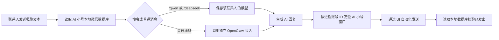

# 微信 AI 小号桥接项目进度总结

更新日期：2026 年 9 月 19 日

## 项目目标

将一个普通个人微信号作为独立 AI 账号使用。其他微信联系人向该账号发送普通私聊文本后，电脑上的桥接程序自动读取消息，调用 OpenClaw 中的 DeepSeek 或本地 Qwen 生成回答，再通过该微信号回复。

## 当前结论

核心流程已经可用，并完成多人私聊、模型切换、Windows 登录后自启和电脑微信双开场景验证。桥接程序当前正在后台运行，任务计划程序最近一次启动结果为成功，自动测试共 8 项，全部通过。

发送端使用 `wechatauto-replica` 的 Windows UI 自动化能力。消息生成和处理由程序自动完成，但实际发出微信消息时仍需要一个已登录、可见且可操作的电脑微信窗口，尚未改为微信后台协议接口。

## 已完成内容

### 普通微信私聊自动回复

- AI 小号收到普通私聊文本后自动回复。
- 已移除原先只允许主号触发的白名单限制。
- 当前会处理所有普通联系人私聊。
- 群聊、公众号、微信系统会话、文件传输助手和非文本消息不会触发回复。
- 新启用联系人不会重放历史消息。
- 消息在调用外部模型前先记录处理水位，防止程序异常重启后重复回复。

### 离线恢复逻辑

- 程序启动或 AI 小号窗口从不可用状态恢复时，不把离线积压消息正文交给模型。
- 离线期间发送的 `/qwen`、`/deepseek` 不会执行。
- 同一联系人离线期间无论发送多少条消息，只回复一次“当前模型已上线，如有需求可以现在开始对话”。
- 积压消息处理水位推进到最新，恢复后的新消息继续进入正常对话流程。

### 多联系人隔离

- 每位联系人使用独立的 OpenClaw 会话键。
- 不同联系人的上下文不会互相串联。
- 每位联系人有独立的模型选择状态。
- 当前状态文件记录了 3 个私聊会话，当前均选择 Qwen。

### 模型切换

联系人可在私聊中发送以下命令：

- `/deepseek`：切换到 DeepSeek V4 Pro。
- `/qwen`：切换到本地 Qwen。

新联系人的初始模型为 DeepSeek V4 Pro。模型切换命令已经完成实际收发验证。

### OpenClaw 隔离配置

- 新建了专用于公开微信私聊的 OpenClaw 智能体 `wechat-public`。
- 工具权限配置为 `minimal`。
- 微信联系人不能通过聊天让该智能体执行本机命令或修改本机文件。
- DeepSeek 配置：`deepseek/deepseek-v4-pro`。
- Qwen 配置：`ollama/fredrezones55/Qwen3.5-Uncensored-HauhauCS-Aggressive:9b`。

### 快速联系人检索

- 发送回复前，从 AI 小号本地联系人数据库读取目标备注或昵称。
- 当名称能够唯一对应目标账号时，直接使用名称打开会话，跳过先搜索 `wxid` 再筛选昵称的过程。
- 同名联系人继续使用保守的原定位流程，防止发错人。
- 同一联系人首次打开会话较慢；会话打开后，后续回复会明显加快。
- 日志已经分别记录模型生成耗时和微信发送耗时，便于后续优化。

### 电脑微信双开适配

- 当前微信版本为 4.1.13.65，已确认可以双开。
- `wechatauto-replica` 能从每个微信进程内读取登录账号 ID。
- 桥接程序按照账号 ID 查找 AI 小号对应的窗口，不依赖窗口顺序、窗口大小或当前前台窗口。
- 已在主号和 AI 小号两个窗口同时打开时完成真实回复验证。
- 如果找不到唯一的 AI 小号窗口，程序会暂停发送并保留待处理消息，避免从主号误发。

### Windows 登录后自启

- 任务计划程序名称：`Codex-WeChat-AI-Bridge`。
- 触发方式：当前 Windows 用户登录后启动。
- 运行方式：隐藏的 PowerShell 启动 Python 后台进程。
- 多实例策略：忽略重复启动。
- 最近一次任务运行结果：`0`，表示任务启动成功。
- 采用登录触发而非系统启动前触发，因为微信窗口自动化需要交互式桌面会话。

## 当前运行状态

| 项目 | 当前状态 |
| --- | --- |
| 桥接后台进程 | 正在运行 |
| Windows 自启任务 | 已启用 |
| 自启最近结果 | 成功，结果码 0 |
| AI 小号窗口识别 | 当前成功 |
| 当前可见微信主窗口 | 1 个，识别为 AI 小号 |
| 已记录私聊会话 | 3 个 |
| 当前会话模型 | 3 个会话均为 Qwen |
| 自动测试 | 9 项通过 |
| `wechatauto-replica` 版本 | 提交 `f4fdf73621f667bb68df221c4301be7222770bf6` |

## 工作流程



## 已完成验证

- 主号向 AI 小号发送私聊，AI 小号自动回复。
- 另一个微信联系人向 AI 小号发送私聊，AI 小号自动回复。
- `/qwen` 和 `/deepseek` 切换确认消息正常。
- 每位联系人独立保存模型和 OpenClaw 会话。
- 双开主号与 AI 小号后，程序正确选择 AI 小号窗口发送。
- 回复发出后，可在 AI 小号本地数据库中核验对应消息。
- 2026 年 9 月 19 日上午再次验证 DeepSeek 生成和回复成功。
- 9 项单元测试全部通过，覆盖消息分类、模型命令、离线消息正文隔离、发送核验、状态保存、联系人唯一匹配和双窗口账号选择。

## 已知限制

### 发送仍依赖微信界面

`wechatauto-replica` 使用 UI Automation，必要时回退到 OCR、剪贴板和输入事件。因此：

- Windows 用户必须保持登录。
- AI 小号必须登录电脑微信。
- 桌面需要处于解锁状态。
- 发送时微信窗口可能被短暂唤醒或获得焦点。
- 微信界面或版本更新后，控件定位可能需要重新适配。

### 群聊尚未启用

当前代码明确跳过 `@chatroom` 会话。群聊内不会回复，群聊中的 `/qwen` 和 `/deepseek` 也不会生效。如果后续启用，建议只在群成员明确 `@AI 小号` 时触发。

### 暂无普通个人号官方后台发送接口

已检索的开源 Hook 项目可以在特定微信版本中通过本地 HTTP 接口发送消息，但尚未找到经过验证、可直接用于 4.1.13.65 的现成替代方案。腾讯 OpenClaw 微信插件可以通过 iLink 接口后台收发，但消息来自独立 ClawBot 会话，不能代表当前普通微信 AI 小号。

### 窗口短暂不可见

日志中出现过 AI 小号窗口暂时无法匹配的情况。程序会保留消息并继续轮询；窗口恢复可见后继续处理。2026 年 9 月 19 日最新核对时，AI 小号窗口识别正常。

### 失败消息不会自动重复发送

为避免重复回复，消息在调用模型前即记录为已处理。如果模型生成或微信发送最终失败，会回复统一错误提示或在日志中记录失败，不会无限自动重发原消息。

## 主要文件

| 文件 | 用途 |
| --- | --- |
| `outputs/WeChatAI/bridge.py` | 主桥接程序 |
| `outputs/WeChatAI/config.json` | 本机账号、模型和轮询配置 |
| `outputs/WeChatAI/start.ps1` | 启动后台桥接 |
| `outputs/WeChatAI/stop.ps1` | 停止后台桥接 |
| `outputs/WeChatAI/enable_autostart.ps1` | 创建登录自启任务 |
| `outputs/WeChatAI/disable_autostart.ps1` | 移除登录自启任务 |
| `outputs/WeChatAI/README.md` | 使用说明 |
| `work/test_bridge.py` | 自动测试 |
| `work/wechat_ai_bridge_state/state.json` | 各联系人消息水位与模型状态 |
| `work/wechat_ai_bridge_state/bridge.log` | 运行、耗时和错误日志 |
| `work/wechatauto-replica` | 固定版本的社区组件源码 |

## 常用操作

在项目目录中执行：

```powershell
# 启动
& .\outputs\WeChatAI\start.ps1

# 停止
& .\outputs\WeChatAI\stop.ps1

# 重新创建登录自启任务
& .\outputs\WeChatAI\enable_autostart.ps1

# 运行测试
& .\work\.venv\Scripts\python.exe -m unittest work.test_bridge -v

# 查看最新日志
Get-Content .\work\wechat_ai_bridge_state\bridge.log -Tail 30
```

## 后续可选工作

1. 增加群聊支持，并限定为仅在 `@AI 小号` 时回复。
2. 缓存已经验证过的联系人与窗口映射，进一步减少首次回复耗时。
3. 增加失败队列和有限次数重试，同时使用消息 ID 保证不会重复发送。
4. 继续跟踪支持微信 4.1.13.65 的开源后台发送方案，成熟后替换 UI 自动化发送层。
5. 增加本地状态查看页，展示运行状态、联系人模型、最近耗时和错误信息。
